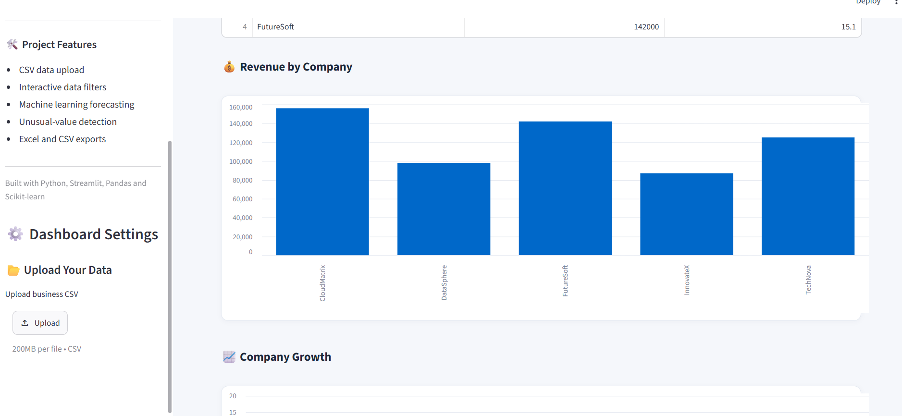
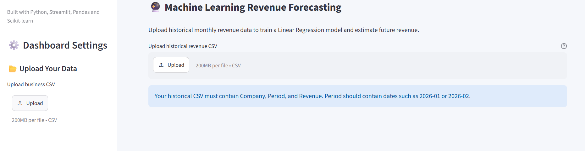

🚀 BizIntel AI – AI-Powered Business Intelligence Dashboard

  <strong>Transform Business Data into Actionable Insights</strong>

  
  
  
  

📌 Project Overview

BizIntel AI is an interactive Business Intelligence application developed using Python. It combines business analytics, data visualization, and CV upload functionality in a single dashboard.

The application helps users explore business performance metrics, view company information, understand revenue trends, and upload CV documents through a user-friendly interface.

✨ Key Features

* 📊 Interactive Business Intelligence Dashboard
* 🏢 Company Information and Data Table
* 📈 Revenue Analytics and Visualization
* 📄 CV Upload Functionality
* 🤖 CV Processing and Analysis
* 💻 Simple and User-Friendly Interface

🛠️ Technology Stack

Technology	Purpose
Python	Core programming language
Streamlit	Interactive web dashboard
Data Analysis Libraries	Business data processing
Visualization Libraries	Charts and graphs

See requirements.txt for the exact installed dependencies.

## 📸 Application Screenshots

### 1. Main Dashboard

### 2. Revenue Analytics

### 3. CV Upload

Add your actual application screenshots here.

Dashboard

<!-- Add dashboard screenshot here -->

Revenue Analytics

<!-- Add revenue chart screenshot here -->

CV Upload

<!-- Add CV upload screenshot here -->

⚙️ Installation and Setup

Prerequisites

* Python 3.x
* Git
* Visual Studio Code (recommended)

Step 1: Clone the Repository

git clone YOUR_GITHUB_REPOSITORY_URL

Step 2: Navigate to the Project

cd BizIntelAI

Step 3: Create a Virtual Environment

python -m venv .venv

Step 4: Activate the Environment (Windows)

.venv\Scripts\activate

Step 5: Install Dependencies

pip install -r requirements.txt

Step 6: Run the Application

streamlit run app.py

Open the localhost URL displayed in your terminal.

🎯 Project Objectives

* Simplify business data analysis.
* Improve business performance visibility.
* Present data through interactive visualizations.
* Provide convenient CV upload and processing.
* Demonstrate practical applications of Python-based analytics.

🔮 Future Enhancements

* AI-powered business recommendations.
* Predictive business analytics.
* Automated business report generation.
* Advanced CV scoring and candidate matching.
* Database integration.
* Downloadable analytics reports.

👨‍💻 Developer

Karthikeya

B.Tech – Computer Science and Engineering

Areas of Interest:

* Artificial Intelligence
* Python Development
* Data Analytics
* Business Intelligence

⭐ Support

If you find this project interesting, consider giving this repository a star!

⸻

Built with Python, curiosity, and innovation.
